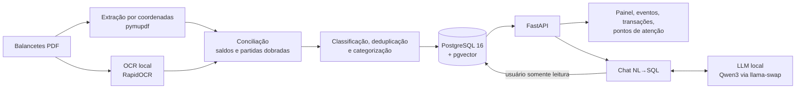

# Auditoria de balancetes com LLM local

Sistema que transforma os balancetes mensais em PDF de um clube social e esportivo (2025 e 2026) em uma base
PostgreSQL **conferida centavo a centavo** e permite consultá-la **em português**, com um chat NL→SQL que roda
em LLMs locais (Qwen3) numa GPU de 6 GB. Nenhum dado sai da máquina.

> Projeto real, publicado como portfólio. Os dados do clube (nome, CNPJ, contas, valores, fornecedores) ficam
> só no `.env` e nas pastas ignoradas pelo Git; o código, os testes e a documentação não contêm dados reais.

## Destaques

| | O quê | Como |
|---|---|---|
| 📄 **Extração de PDF** | Extratos bancários (2 layouts) e Balancete Analítico contábil | Leitura pela **posição das palavras** (pymupdf), não por regex de texto corrido |
| 🔍 **OCR local** | Mês em que o extrato veio como desenho vetorial | RapidOCR + correção pelo vocabulário dos meses com texto |
| ✅ **Conciliação** | 18 meses, 100% conferidos | saldo anterior + lançamentos = saldo impresso; partidas dobradas no balancete |
| 🤖 **Chat NL→SQL** | Pergunta em português → SQL → resposta | LLM local, *schema linking* determinístico, travas de segurança |
| 📊 **Benchmark** | 43 perguntas com SQL de referência | Acerto do Qwen3-8B de **57% → 98%**, medido também em perguntas de validação novas |
| 🔒 **LGPD** | CPFs de sócios nos PIX recebidos | Mascarados em toda resposta da API |

## Arquitetura



### O chat NL→SQL em detalhe

1. **Schema linking** (`dicas_esquema`): antes do LLM, o código procura na pergunta nomes de contas do balancete e
   categorias que existem no banco e acrescenta dicas curtas e determinísticas (ex.: "Natação é conta de receita do
   balancete: use a coluna crédito"; "a pergunta não pede valores por mês: some o período inteiro").
2. **Geração**: o Qwen3-8B recebe o esquema, as regras e as dicas, e devolve o SQL em JSON.
3. **Travas**: só `SELECT`/`WITH`, lista de palavras proibidas, `LIMIT 500` forçado, execução como papel
   `leitor` (somente leitura, timeout de 15 s) e uma tentativa de correção automática se o SQL falhar.
4. **Resposta conferida**: o LLM redige a resposta e `numeros_conferem` descarta a frase se ela citar um número
   que não está no resultado (contra alucinação). Tudo fica em `consultas_log`.

### Resultados do benchmark

Perguntas em português com SQL de referência escrito à mão; o resultado do modelo precisa conter os números e nomes
da referência. As perguntas de *validação* foram escritas depois de cada rodada de ajustes e medidas antes da
mudança seguinte, para não medir só aquilo que foi ajustado.

| Versão do chat | Qwen3-8B | O que mudou |
|---|---|---|
| v1 | 57% | Prompt original |
| v2 | 74% | Regras no prompt (total × mês, comparação de períodos com `FILTER`, direção de pagamentos) |
| v3 | 91% | + schema linking determinístico |
| v4 | **98%** | + dica de total × mês a mês |

Na v4, o Qwen3-30B-A3B (MoE) fez 95%; o 8B ficou como padrão por ser mais rápido (8,9 s por pergunta) e caber na GPU.
A lição principal: um modelo de 8B não consulta bem listas longas dentro do prompt, mas segue muito bem uma dica
curta e específica gerada por código. Detalhes e ressalvas em [`avaliacao/RESULTADOS.md`](avaliacao/RESULTADOS.md).

### Stack

Python 3 · PostgreSQL 16 + pgvector (Docker) · FastAPI · JavaScript puro · pymupdf · RapidOCR (ONNX) ·
llama.cpp / llama-swap e Ollama · Qwen3-8B, Qwen3-30B-A3B, Qwen2.5-7B · pytest · openpyxl

## Situação atual (fase 1: carga)

- 18 balancetes carregados (jan/2025 a jun/2026), **todos conferidos com o banco**:
  - saldo corrido: saldo anterior + lançamentos = saldo impresso pelo banco, em cada trecho;
  - resumo mensal (out/2025 em diante): soma de créditos e débitos = totais do resumo de cada conta.
- Jul/2025 veio com o extrato desenhado como imagem vetorial: lido por OCR local (RapidOCR),
  também conferido 100% pelo saldo.
- Lançamentos repetidos entre impressões do extrato (ex.: 16/06/2025 nas duas quinzenas,
  01/09/2025 no extrato de agosto) são marcados em `duplicada_de` e ficam fora das análises.
- Aplicações, resgates e transferências entre contas do clube são marcados como `interna`.

## Como usar

```bash
docker compose up -d                                   # banco (porta 5433)
.venv/Scripts/python -m pcsf.carga "balancetes pcsf"   # carrega PDFs novos da pasta
.venv/Scripts/python -m pcsf.carga "balancetes pcsf" --recarregar   # refaz tudo
```

Novo mês: salve o PDF em `balancetes pcsf/` com o nome `Balancete AAAA-MM-MES.pdf` e rode a carga.
Arquivos já carregados são reconhecidos pelo hash e ignorados.

Banco: `postgresql://auditoria:<senha do .env>@127.0.0.1:5433/auditoria`

### Configuração (`.env`)

Copie `.env.example` para `.env` e preencha. Além da senha do banco e do LLM, o `.env` guarda os dados que
identificam o clube (nome, CNPJ, contas bancárias), lidos por `pcsf/clube.py`. Eles ficam fora do Git;
sem eles o sistema roda, mas não reconhece as transferências entre contas do clube como internas.

Também ficam fora do Git: `db/init/900_contas_local.sql` (contas do balancete acompanhadas, no formato do
exemplo em `db/init/007_balancete_despesas.sql`) e `avaliacao/apelidos.json` (nomes reais das contas que as perguntas
do benchmark citam com nomes fictícios).

## Site (painel, eventos, transações, pontos de atenção, chat, documentos)

Jeito mais fácil: dê dois cliques em **`iniciar_site.bat`** na pasta do projeto. Ele sobe o banco, inicia o site
e abre o navegador (porta 8500, ou 8501 se a 8500 estiver ocupada). Para parar, feche a janela.

Pelo terminal do Windows (PowerShell), na pasta do projeto:

```bash
.venv\Scripts\python -m uvicorn web.app:app --port 8500      # abrir http://127.0.0.1:8500
```

- **Painel**: entradas × saídas por mês, para onde vai o dinheiro, gastos com eventos por mês.
- **Eventos**: gastos por categoria, 1º semestre 2025 × 2026, maiores fornecedores, cadastro de eventos
  (Instagram) e cruzamento evento × gastos numa janela de dias ajustável.
- **Transações**: filtros, exportação para Excel, e clique numa linha para ver a página do balancete com o lançamento destacado.
- **Pontos de atenção**: padrões que merecem esclarecimento (não são conclusões).
- **Chat**: pergunta em português → o LLM gera SQL → o banco calcula (usuário somente leitura) → resposta.
  O SQL fica visível e registrado em `consultas_log`. Uma trava confere se cada número citado na resposta
  existe no resultado; se não existir, a frase é descartada e só a tabela é mostrada. Exporta Excel e texto.
- **Documentos**: arquivos carregados, páginas, OCR, conferência com o banco.
- CPFs aparecem mascarados (LGPD).

## Balancete contábil e movimentos selecionados

Duas extrações separadas, cada uma com sua conferência:

| | Origem | Onde fica | Conferência |
| --- | --- | --- | --- |
| **Balancete** | Balancete Analítico (contabilidade) | tabela `balancete`; visão `v_balancete_selecionado` com as contas de `balancete_filtros` | débitos = créditos, totais de grupo = soma das contas, saldo anterior + débito − crédito = saldo atual |
| **Movimentos financeiros** | Extratos bancários | visão `movimentos_financeiros` (8 strings) sobre `transacoes` | saldos e totais do banco |

```bash
.venv/Scripts/python -m pcsf.balancete           # (re)carrega o balancete de todos os meses
.venv/Scripts/python -m pcsf.relatorios todos    # saidas/balancete_selecionado.xlsx e saidas/movimentos_financeiros.xlsx
```

- A lista de contas fica em `balancete_filtros` (código, nome e natureza: 35 de receita e 85 de despesa).
  Receita: o valor do mês é o crédito; despesa: o débito. Para acompanhar outra conta, inclua uma linha lá:
  não é preciso reprocessar os PDFs. O casamento é pelo código, porque nomes se repetem em grupos diferentes.
- Strings dos movimentos: Pix recebido, Saque dinheiro, Pagamento fornecedor (inclui TED PGTO FORNECEDORES e
  PAGFOR PIX), Cheque emitido (inclui CH PAGO, COMPENSACAO INTERNA e CHEQUE BCO DEPOSITADO, que são saídas),
  TED enviado, Pix enviado, Dep cheque (inclui DEP DINHEIRO, marcado), TAR (inclui TARIFA). A coluna "variante"
  mostra a forma exata do banco.
- A comparação contabilidade × extrato aparece em Pontos de atenção.
- Na aba Balancete do site: escolha receitas ou despesas, um mês ou um intervalo (De/Até), busque a conta por
  nome ou código e baixe o Excel do período escolhido.

## Categorização assistida (LLM local)

```bash
.venv/Scripts/python -m pcsf.sugerir                 # LLM sugere categoria por recebedor (Qwen3-8B, ~1 min por 12)
.venv/Scripts/python -m pcsf.revisao exportar        # gera saidas/revisao_categorias.xlsx
#   ... revise a coluna amarela "Categoria final" no Excel e salve ...
.venv/Scripts/python -m pcsf.revisao importar        # aplica as decisões no banco
```

A decisão vale por recebedor e é mantida em recargas futuras. Modelo e servidor no `.env`
(`LLM_URL`, `LLM_MODEL`); alternativa: Ollama `qwen2.5:7b` em `http://127.0.0.1:11434`.

## Estrutura

| Caminho | Conteúdo |
| --- | --- |
| `pcsf/extratos.py` | Extração dos extratos Santander (2 layouts) pela posição das palavras |
| `pcsf/ocr.py` | OCR local das páginas sem texto, com cache em `dados/cache_ocr` |
| `pcsf/conciliacao.py` | Conferência da extração contra saldos e resumos do banco |
| `pcsf/classificar.py` | Tipo do lançamento, movimento interno, CPF/CNPJ/nome da contraparte |
| `pcsf/clube.py` | Dados do clube (nome, CNPJ, contas) lidos do `.env` |
| `pcsf/carga.py` | Carga, deduplicação e categorização (revisão > regra > tipo) |
| `pcsf/llm.py`, `pcsf/sugerir.py` | Cliente do LLM local e sugestão de categorias |
| `pcsf/revisao.py` | Revisão das categorias em Excel (exportar/importar) |
| `pcsf/balancete.py` | Extração e conferência do Balancete Analítico |
| `pcsf/relatorios.py` | Relatórios Excel (balancete selecionado, movimentos financeiros) |
| `web/app.py`, `web/static/` | Site: API (FastAPI) e interface |
| `db/init/` | Esquema, categorias, regras, sugestões e usuário somente leitura |

Tabelas principais: `documentos`, `transacoes`, `conciliacoes`, `contrapartes`, `categorias`,
`regras_categoria`, `eventos`. Para análise use a visão `v_movimentos`
(sem duplicatas e sem movimentos internos).

## Limites conhecidos dos dados

- **PIX enviado** traz só o nome do recebedor, cortado em 25 caracteres, sem CPF/CNPJ.
- **PIX recebido** traz o CPF de quem pagou (em geral sócios): dado pessoal, mascarar em apresentações.
- **PAGFOR (pagamento a fornecedores em lote)**: o extrato não mostra quem recebeu.
- **Contas do clube no Sicredi**: registradas no balancete desde jan/2026 (movimento, provisão e fundo de reserva).
  As TEDs do Santander para elas são transferências internas. Os extratos do Sicredi não constam dos balancetes, e a partir de mai/2026 as cobranças de mensalidade
  saem do Santander: comparações 2025 × 2026 ficam incompletas até esses extratos serem incluídos.

## Testes

```bash
.venv/Scripts/python -m pip install -r requirements-dev.txt
.venv/Scripts/python -m pytest
```

## Benchmark de LLMs locais (chat NL→SQL)

Perguntas com SQL de referência (`avaliacao/perguntas.json`) respondidas por cada modelo pelo mesmo caminho do chat;
o resultado do modelo é comparado com o da referência. Resultados em [`avaliacao/RESULTADOS.md`](avaliacao/RESULTADOS.md).

```bash
.venv/Scripts/python -m avaliacao.benchmark chat-8b chat-moe-30b "ollama/qwen2.5:7b"
```

## Próximas fases

- Enriquecimento de CNPJ (dados abertos da Receita: razão social, CNAE, data de abertura, sócios).
- Extratos do Sicredi, se obtidos.
